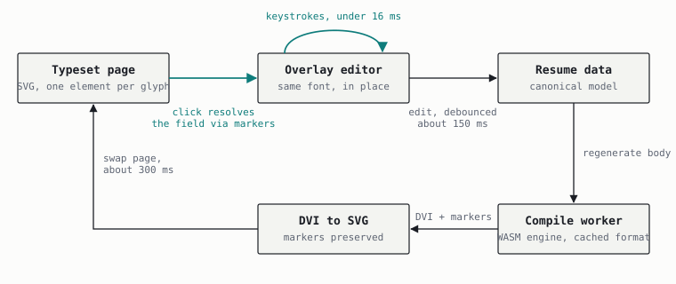

# LaTeX Resume Editor Plan

> Converted on 2026-09-13 from the shared page at https://claude.ai/code/artifact/c9403706-378d-475b-8599-48f4b0c6f569. The page stays the shareable version; this file is the copy that lives with the code.

*A browser editor for one-page LaTeX resumes, where you edit the typeset page itself and never see a line of TeX.*

Version one plan · revised 17 September 2026 · spike done, follow-ups merged

## 1. Key terms

For readers who have never used LaTeX. Every entry is two sentences at most, and the rest of the plan assumes nothing beyond them.

### 1.1 The LaTeX world

- **TeX**: The typesetting program underneath everything here, written by Donald Knuth in the late 1970s. It turns text and commands into precisely laid-out pages, and its output still looks better than most word processors.
- **LaTeX**: A large set of commands built on top of TeX that makes it practical for everyday documents. A resume written in LaTeX is a plain text file of words and commands that a program turns into a PDF.
- **Source, or the .tex file**: The plain text file holding a document's words and commands. It is the code that people using this product never see.
- **Compile**: Running an engine over the source to produce the finished pages. Every change has to be compiled to be seen, which is why compile speed decides whether page editing feels live.
- **Preamble**: The top of a source file, where fonts, page size and the template's commands are set up before any content appears. It is the slow part of every compile, and the part this plan compiles once and saves.
- **Template**: A ready-made design for a document: a preamble plus a set of custom commands that decide fonts, columns and spacing. The author supplies only content.
- **Macro**: A custom command a template defines, such as one that lays out a job entry from a company, a title and dates. Working out what each macro's inputs mean is the heart of importing an unfamiliar template.
- **Package and class**: Add-on files that give LaTeX abilities such as icons, colours or multiple columns, where a class is the add-on that defines a whole document type. Templates lean on both.
- **TeX Live**: The standard distribution of LaTeX: the engines plus thousands of packages and fonts, several gigabytes in all. This plan fetches only the pieces a document actually uses.
- **Format file**: The engine's memory saved to disk after it has read a preamble. Loading it takes milliseconds, where reading the preamble again would take most of a compile.
- **DVI and XDV**: The engine's raw output before it is turned into a PDF, where XDV is XeTeX's version. It is easy for a program to read, which is why the page view is built from it.
- **Glyph**: One drawn character on the page. The page view is built from glyphs, and a click lands on one.

### 1.2 The engines

An engine is the program that does the compiling. LaTeX has three in common use, every template is written for one of them, and a template written for one often will not run on another.

- **pdfTeX**: The classic engine, fast and small. It can only use fonts packaged in its own format, which is enough for most resume templates.
- **XeTeX**: An engine that can use any font a computer has, including icon fonts. Templates with custom fonts or icons usually need it, and it is slower to start.
- **LuaTeX**: The newest engine, which can be programmed with the Lua scripting language. It is the heaviest of the three to run in a browser, so version one refuses templates that need it.

### 1.3 Inside this plan

- **Template package**: Everything the editor needs to know about one template: its preamble, its macros, where markers go, and how its fields map onto the canonical model. Curated and imported templates both end up as one of these.
- **Canonical model**: The one structure every resume is stored in, whatever template it uses: contact details, then sections of entries and lists. It is also what will make switching templates possible later without a migration.
- **Style control**: A setting the user can change without touching the template, such as margins or font size. Each one is a parameter the template package declares, with a fixed range.
- **Marker**: An invisible note the template writes into the output before and after each editable field. It is how the page knows which glyphs belong to which field.
- **Overlay**: The editable box that appears over a field while it is being typed into, set in the same font as the page. It makes typing feel instant while the real compile catches up.
- **Probe**: A compile run only to test whether one part of a template can be marked without changing the document. Probes are how the engine, rather than the AI model, discovers what is editable.
- **Locked chunk**: A part of an imported document that shows on the page but cannot be clicked into, because the pipeline could not prove it safe to edit. It can still be changed by describing the change in words.
- **Corpus**: A collection of a few hundred real resumes gathered for testing. The share of them that import cleanly is the plan's headline quality number.

### 1.4 The web side

- **WebAssembly**: A way to run programs written for ordinary computers inside a web browser at close to full speed. It is how the TeX engines run on the user's own machine with no server involved.
- **Web Worker**: A way for a web page to do heavy work in the background so the page itself never freezes. The compile runs in one.
- **SVG**: A picture format made of shapes and text rather than pixels, which a web page can treat as separate clickable pieces. The typeset page is shown as SVG so that every character can be clicked.
- **CDN**: A network of servers that hands files out quickly from wherever the user happens to be. The pieces of TeX Live come from one.
- **Cache**: A saved copy of something expensive to produce, kept so the next request is instant. This plan caches format files, TeX Live pieces, and the model's analysis of each template.
- **Hash**: A short fingerprint computed from a piece of text, identical whenever the text is identical. It is how the cache recognises a template it has seen before.
- **Debounce**: Waiting a moment after the last keystroke before doing expensive work, so typing a word triggers one compile rather than five.

### 1.5 The AI side

- **Language model**: An AI system that reads text and writes text. Here it has one narrow job, describing what an unfamiliar template's macros mean, and its answers are checked by compiling.
- **Model choice**: Which language model does the naming job is not yet decided, and the first version will probably use a cheap or free one such as Gemini. Because every answer is checked by compiling, the choice affects how much of an import comes out editable and what it costs, never whether what is shown as editable is safe.
- **Structured output**: Asking the model to answer in a fixed, machine-checkable shape rather than free text. The answer can then be used directly by the pipeline without reading prose.
- **Batch processing**: Sending many model requests at once to be processed later, which providers sell at a discount. It is used to analyse popular templates before launch so the first users hit a warm cache.

## 2. Summary

The product is a resume editor that runs in the browser. A person picks one of our templates or imports the `.tex` resume they already have, clicks anywhere on the typeset page, types, and downloads a PDF. The LaTeX that produces the page exists, but nobody who uses the product ever reads or writes it.

BaKoMa TeX Word did direct page editing on real TeX in the 2000s for any LaTeX document, and it was fragile for exactly that reason: an arbitrary document cannot be understood, only run. This plan narrows the target to small, template-shaped documents and makes the tool own the source. Three ideas carry the design.

> **Note.** BaKoMa TeX Word, by Basil Malyshev, was a commercial editor in which you typed straight into the compiled page. It was the closest thing to this product, and it was aimed at TeX experts editing arbitrary documents.

- **The page is the editor.** The view is the real TeX output rendered as SVG, one element per glyph. A click lands on a glyph, the glyph belongs to a field, and the field opens for typing in place.
- **The tool owns the source.** Every document is structured data plus a template package. The LaTeX is generated from those two things, so there is no code in the model for a user to break.
- **The compiler checks the model.** For imported templates, the TeX engine discovers which parts are editable, a language model names and structures them, and compile-based checks accept or reject the result. Anything unproven stays visible but locked.

## 3. Decisions

Everything settled so far, including the defaults chosen on 12 September the two revisions of 13 September, the revision of 16 September that moved template switching out of version one, and the revision of 17 September that records what the spike measured. Rows carrying the default tag were recommendations accepted without discussion, so they are the first to revisit if something feels wrong in practice.

| Question | Decision | What it changes |
|---|---|---|
| Who edits | Non-technical people with small documents | No escape hatch may ever show LaTeX |
| First documents | Resumes. Cheat sheets later | No math editor and no free-form columns in version one |
| Where it runs | The browser | TeX engines compiled to WebAssembly, packages fetched on demand |
| Edit surface | The real typeset page | The compile sits in the edit loop; an overlay covers the gap |
| Where templates come from | Curated templates plus import of any `.tex` | Both paths produce the same template package |
| Understanding imports | Macro semantics inferred by a model and cached | The engine probes first, the model names second, the compiler validates last |
| Which model | Undecided; probably a cheap or free model such as Gemini first | The model is called in one place against a fixed schema, and the corpus benchmarks candidates |
| Output | PDF only | Generated LaTeX need not be readable; imports can be normalised freely |
| Structure editing | Side panel, with text edited on the page *(default)* | The cheapest interaction layer, reversible later |
| Style controls | In version one, with the fixed set in section 5.4 | Controls are parameters applied after the format is saved, so a change costs one ordinary compile |
| Languages | English first | Latin fonts only; pdfTeX suffices for curated templates |
| Storage | Browser storage plus accounts with cloud save | A document store, not a live sync engine |
| Collaboration | None in real time | No shared editing state, no presence, no merging |
| Template switching | Later. Version one keeps one template per document | The canonical model stays, so switching can be added later without a migration |
| LaTeX or Typst | LaTeX, because importing LaTeX templates is the point | Settled and not raised again |
| Engines at launch | pdfTeX and XeTeX *(default)* | LuaTeX imports are refused with a clear message |
| Import intake | A single `.tex` or a zip *(default)* | Overleaf links later; Overleaf exports a zip anyway |
| Locked content | Shown locked, with a describe-in-words edit *(default)* | The model rewrites the chunk, the compiler checks it |
| Import success bar | Identical output and 90% of body words editable *(default)* | Below the bar an import is labelled partial |
| Shared cache | Yes, with personal data stripped *(default)* | Originals stay in the owner's account only |
| Launch templates | Jake's Resume, AltaCV, Awesome-CV *(default)* | Covers pdfTeX, icons, two columns and XeTeX |
| Tech stack | TypeScript throughout, React, TeX engines built to WebAssembly from TeX Live sources *(default)* | Four parts are written from scratch; everything else is assembled, see section 8 |
| Hosting | Cloudflare for files and the model endpoint, Supabase for sign-in and saved resumes *(default)* | Downloads are free on one, accounts are nearly free to build on the other |
| XeTeX fonts | Declared in the format by file name, with fontspec removed from the class at import time (decision 0003) | A format cannot hold a loaded system font, so nothing loads until the first compile; Awesome-CV compiles in about half a second instead of ten |
| Overlay line breaking | The overlay breaks lines with TeX's own algorithm and the font's metrics (decision 0004) | A multi-line field sits within a pixel of the page; the template package carries each field's paragraph settings |

## 4. Scope of version one

### 4.1 In

- Three curated templates, each a hand-written template package.
- Import of a single `.tex` file, or a zip holding the document with its class files, style files and images.
- Text editing in place on the typeset page, with instant feedback in an overlay and the true page following within the target time.
- Adding, removing and reordering entries and sections from a side panel.
- Style controls: page size, margins, font size, font, accent colour, density and date format, plus a fit-to-one-page action.
- PDF download.
- Documents saved in the browser, and in the user's account once they sign in.
- English text and Latin fonts.

### 4.2 Out, with the door left open

- Cheat sheets, and the visual math editor they would need.
- Switching templates with content preserved. The canonical model is built so this can be added later.
- Style controls beyond the version-one set, such as heading styles, bullet shapes and column widths.
- Icon fonts and system fonts beyond what the launch templates use. XeTeX ships at launch, so this is a template question rather than an engine question.
- Non-Latin scripts.
- Real-time collaboration.
- Exporting `.tex`.
- LuaTeX templates, Overleaf links, and importing from a PDF alone.

### 4.3 Targets

These are the bar the spike has to clear, not measurements. A slow laptop means a 2019 machine with integrated graphics.

| Path | Target |
|---|---|
| Keystroke in the overlay | under 16 ms |
| True page updated after an edit, typical | 300 ms |
| True page updated after an edit, slow laptop | under 500 ms |
| Import, template already cached | under 5 s |
| Import, cache miss including the model call | under 60 s |
| First load, cached afterwards | under 30 MB |

Measured on 17 September on an M4 Pro, with the slow laptop still to come: the page updates in 100 to 110 ms for Jake's Resume and 459 ms for Awesome-CV, the first load is about 14 MB compressed, and the overlay sits within a pixel of the page.

## 5. Architecture

### 5.1 The template package

A template package is the one artefact everything else consumes. It holds the preamble verbatim, a schema for each custom macro and environment the template defines, a marker strategy for each editable argument, the parameters a future style panel will expose, and a mapping from the template's fields onto the canonical model. Curated packages are written by hand. Imported packages are produced by the pipeline in section 6 and cached. The editor cannot tell the difference, which is what lets an imported package that a person has reviewed simply become a curated template.

> **Note.** The spike answered the first question it was asked: XeTeX cannot keep system fonts inside a format file. The format holds font declarations that name the files instead, and nothing loads until the first compile, which brings Awesome-CV to about half a second (decision 0003).

### 5.2 The canonical model

Every document is stored in one model regardless of template: a header with contact fields, then sections, each holding either entries with a title, subtitle, place, date range and bullets, or a plain list such as skills. Each package maps its macros onto that model, and the generator walks the model to emit the template's LaTeX. Fields an imported template has and the model lacks are kept as template-specific extras, so nothing is lost on import. Template switching is not in version one, but because every document already lives in this model, adding it later is a feature rather than a migration.

> **Note.** RenderCV is an open-source tool that renders a YAML resume through LaTeX themes. It is the closest existing example of a canonical model with a mapping per template, and worth reading before designing ours.

### 5.3 Client

The page is an SVG built by us from the engine's output, one element per glyph, so a hit test is a DOM lookup. Clicking a glyph finds its field through the markers around it and opens an editable overlay positioned exactly over the field, set in the document's own font served as a web font. The overlay breaks its lines with TeX's own algorithm and the font's metrics, so a multi-line field sits within a pixel of the page (decision 0004). Keystrokes land in the overlay instantly. The edit is applied to the model after a short debounce, and when the recompile lands, the fresh page replaces the old one and the overlay closes. A side panel holds structure: add or remove an entry, reorder sections. Documents live in a local-first store in the browser and sync to the account when one exists.

### 5.4 Style controls

Resumes are edited to fit, so the controls that change how much fits are in version one. The set is deliberately small. Each control is one parameter with a fixed range, which keeps every template predictable and keeps fit-to-one-page a short search rather than an open-ended one.

| Control | Choices | Notes |
|---|---|---|
| Page size | US Letter, A4 | Defaults from the browser's locale |
| Margins | 0.4 to 1.0 inch in steps of 0.1, the same on all sides | A slider with Tight, Normal and Roomy marked on it |
| Font size | 9 to 12 pt in half-point steps | The usable range for a resume; the template's own size is the default |
| Font | Three or four families per template | Only families the template's engine can load from TeX Live, so a choice never changes the engine |
| Accent colour | A short palette plus a custom picker | Applies wherever the template uses colour: headings, rules, icons |
| Density | Compact, Normal, Relaxed | Scales the space between sections, entries and bullets together |
| Date format | Jan 2024, January 2024, 01/2024, 2024 | One setting for every date in the document |
| Fit to one page | An action, not a setting | Steps density, then margins, then font size until the document fits, and undoes in one click |

Section order is a structure edit and lives in the side panel with the other structure edits.

Every control is a parameter declared in the template package with a type and a range, and the controls are applied after the point at which the preamble has been saved as a format file. That ordering is what keeps them fast. Page geometry, colours and fonts can all be set after the packages have loaded, so changing a control costs one ordinary compile, the same as typing. Font size is the exception, because some classes fix it when they load; those templates get one saved format per size, which is a handful of small files.

Imported templates get the controls the pipeline can prove. Page size, margins and font size can be overridden generically and are probed like any macro argument. Accent colour, font, density and date format appear only where the model finds the matching parameter in the preamble and a probe confirms that overriding it changes the output without breaking the compile.

Fit to one page runs a short search in the worker: one step of density, then one of margins, then one of font size, compiling after each, and it stops at the first setting that fits. At the target compile time it finishes in a few seconds.

### 5.5 Compile worker

A Web Worker hosts pdfTeX and XeTeX compiled to WebAssembly. TeX Live files are fetched on demand from a CDN and cached locally, so the first compile of a template pulls what it needs and later ones pull nothing. Each preamble is compiled once into a format file and cached, which removes most of the cost of every later compile. Output is DVI, or XDV from XeTeX, rather than PDF. Our converter turns it into SVG with the markers preserved. The PDF for download comes from the same output through the engines' standard drivers, also compiled to WebAssembly.

The spike built this loop and measured it: pdfTeX from a saved format in about 100 ms, XeTeX with fontspec removed and the fonts declared in the format in about 460 ms, TeX Live files fetched one by one as TeX opens them so a first load is about 14 MB compressed and a body compile fetches 0.06 MB, Type 1 fonts read in the browser, and XDV's native-font runs drawn from the font files. The stock format is fetched only to build a template's own format; serving template formats from the cache would remove it from the first load.

> **Note.** Markers written with `\special` pass through DVI untouched, and the on-screen page and the downloaded PDF come from the same output, so the two cannot disagree.

***Figure 1. The edit loop.** The teal path is instant: a click resolves a field and keystrokes land in the overlay. The dark path is the compile: the debounced edit regenerates the body, the worker recompiles from the cached format, the converter rebuilds the SVG, and the new page swaps in under the overlay.*

### 5.6 Backend

Sign-in, a document store, the shared package cache, the model endpoint and the TeX Live CDN. The document store holds the structured data, a reference to the package, and for imports the original upload, visible only to its owner. There is no synchronisation engine because nothing is edited by two people at once. Section 8 names the services behind each of these and what they cost.

### 5.7 Validation harness

One code path checks packages. In continuous integration it runs against the curated templates on every change. At import time it runs in the user's browser against the freshly inferred package. A corpus of a few hundred public resumes, collected before the pipeline exists, is the regression suite, and the fraction of them that import fully editable is the number the whole import effort is measured by.

## 6. Import pipeline

Six steps, in order. Everything except step four runs in the user's browser, because the engine is already there.

1. **Intake.** Accept a `.tex` or a zip. Find the main file by looking for the document class. Detect the engine from the class and packages: font loading through fontspec or polyglossia means XeTeX, and anything that needs Lua is refused with a message that says so. Compile the original once to have a reference output.
2. **Parse.** A fault-tolerant parser turns the body into a tree. Standard LaTeX becomes rich text: bold, italic, links, lists. Calls to macros the template defines become typed calls. Anything the parser cannot place becomes a raw chunk that is preserved byte for byte.
3. **Probe.** Every argument of every custom macro call is wrapped in markers and the document is compiled. Arguments whose markers come out intact around exactly their text are editable prose. Arguments that break the compile or vanish are lengths, colours, icon names or keys, and are found by re-running with one probe at a time. Text in the output that no marker covers is locked.
   > **Note.** Probing is what keeps the model honest: it only ever names what the engine has already shown to be editable.
4. **Name and structure.** The macro definitions, with personal data stripped, and a few call sites with their text replaced by placeholders of the same length go to the server. The server checks the cache by macro hash first. On a miss it asks the language model, with a structured output schema so the reply is valid by construction, for the meaning of each argument, which macros are repeatable entries, headers or bullets, which pairs open and close lists, what a blank entry looks like, how the fields map onto the canonical model, and which preamble settings are style parameters such as geometry, base font size, fonts and colours. Large class files are analysed macro by macro with the class text reused across calls. Which model answers is an open choice, covered in section 6.4.
5. **Validate.** Four checks, each a compile. The body regenerated from the tree must produce the same glyph stream as the reference, markers stripped. Every field mutated with long, empty and special-character text must still compile. Adding and removing an entry of every repeatable type must still compile. Every style parameter the model identified is overridden and compiled, and becomes a control only if the output changes and nothing breaks. Anything that fails a check is demoted to locked, or dropped in the case of a style parameter.
6. **Package and report.** The package is assembled, the document opens in the editor, and the import report states the share of body words that are editable and lists what is locked. Below the bar in section 6.2 the report says partial and the user decides whether to continue.

***Figure 2. The import pipeline.** Everything runs in the browser except naming and structuring. The teal arrow is the only thing that leaves the device: macro definitions and placeholdered call sites, never the resume's content. A cache hit skips the model entirely.*

### 6.1 Locked content

Locked chunks render exactly as they did in the original and show a lock when hovered. Their edit box takes a sentence such as "change the phone number to the new one" rather than a cursor. The model rewrites only that chunk, the compiler checks that the document still compiles and that nothing outside the chunk moved, and the user sees either the new page or a plain refusal. The user never sees the LaTeX in either case.

### 6.2 Success bar

An import succeeds when the regenerated document produces the same glyph stream as the original, markers stripped, and at least 90% of body words are editable in place. Below that, the report labels the import partial, lists the locked parts, and lets the user continue or stop. The corpus measures both conditions across real documents.

### 6.3 Shared cache and privacy

What the model works out about a template is saved once and reused for everyone who imports a template with the same macros, keyed by a hash of each normalised definition and its dependencies. Caching per macro rather than per file matters because forks of popular templates change one macro's spacing and leave the other nine alone. Only definitions and placeholdered call sites are sent or stored. Names, addresses, emails, phone numbers and links found inside definitions are stripped before anything leaves the browser, and cache entries are audited on a schedule. The original upload is stored in its owner's account and nowhere else.

### 6.4 Model choice, cost and time

The model is not chosen yet. The first version will probably use a cheap or free model such as Gemini, and the design keeps that choice cheap to change: the model is called in exactly one place, it is asked for a structured answer against a fixed schema that any serious provider can produce, and every answer is checked by compiling before a user sees it. A weaker model lowers the share of imports that come out fully editable and raises how much ends up locked. It never makes something unsafe look editable. The corpus is the benchmark: run each candidate over the same few hundred resumes, compare the editable rate against the cost per import, and standardise on whichever wins.

A cache miss costs one model call and a few dozen probe and validation compiles, which lands inside the 60 second target with a progress display that names each step. A cache hit costs only the compiles. The top templates get analysed ahead of launch through the provider's discounted batch processing, so the first users hit a warm cache.

## 7. Launch templates

Three ports rather than original designs, chosen so that between them they exercise every path the engine layer has to support. All three are popular enough that many imports will be forks of them, which means their reviewed packages also serve as import cache entries from day one.

| Template | Engine | Layout | Licence | Why |
|---|---|---|---|---|
| Jake's Resume | pdfTeX | single column | MIT | The most forked software resume on GitHub |
| AltaCV | pdfTeX | two columns, icons | MIT | Exercises columns and icon fonts without XeTeX |
| Awesome-CV | XeTeX | single column, custom fonts | LPPL | Forces the XeTeX and system-font path early |

Confirm each licence before porting.

> **Note.** The LaTeX Project Public License allows modified copies but asks that they not be presented as the original, which in practice means renaming the ported class and keeping attribution.

## 8. Tech stack and hosting

Everything is written in one language, TypeScript, and runs in three places: the user's browser, a background thread inside that browser, and a small server. The stack is chosen so that the four things nobody else has built, the page converter, the marker-driven overlay editor, the template packages and the import pipeline, are the only things written from scratch. Everything else is assembled from open-source parts.

### 8.1 The stack

| Layer | Choice | Why |
|---|---|---|
| Language | TypeScript everywhere | One language for the app, the background thread, the import pipeline and the server; the engines are driven through JavaScript anyway |
| App | React with Vite | A commodity choice; none of the hard parts live in the framework |
| Typing in fields | ProseMirror through Tiptap, with only bold, italic and link | A predictable document model that maps one-to-one onto the LaTeX equivalents |
| Document state | The canonical model as plain JSON, checked with Zod, with a command stack for undo | Simple, and it saves and syncs as one blob |
| Local storage | IndexedDB through Dexie for documents and formats; the browser's Cache API for TeX Live files | Immutable files suit ordinary HTTP caching; documents need lookups |
| TeX engines | pdfTeX and XeTeX built to WebAssembly with Emscripten from TeX Live sources, starting from BusyTeX's build scripts | An own build keeps licensing to TeX's own terms and leaves room for an engine patch later |
| Engine host | One Web Worker, one engine loaded at a time, files fed on demand | Keeps memory down on old laptops |
| TeX Live on demand | A static copy of the needed TeX Live files in object storage behind a CDN, with a manifest | Fetch only what a document uses, then cache it for good |
| Page rendering | An own DVI and XDV to SVG converter in TypeScript, started from dvi2html | Exact per-glyph positions, markers preserved, an SVG the browser can hit-test |
| Web fonts | Web fonts made from each template's own font files, Computer Modern's Type 1 outlines included, so the overlay uses the page's exact glyphs | Needed for the overlay; the SVG draws the outlines directly |
| PDF export | dvipdfmx and xdvipdfmx built to WebAssembly | The download comes from the same output as the screen, so the two cannot differ |
| LaTeX parsing | unified-latex | The only serious JavaScript parser with a forgiving tree and a printer |
| Model endpoint | A small HTTP function on the Vercel AI SDK's provider layer, asking for a structured answer against a fixed schema | The model is undecided; switching providers is a one-line change |
| Package cache | A key-value store keyed by macro hash | Cheap, shared by everyone, and the hit path never touches a model |
| Sign-in and saved resumes | Supabase: its sign-in, database and file storage, used directly from the browser | The least code that gets accounts working |
| Files and the server | Cloudflare: Pages for the app, R2 for the engine, fonts, TeX Live files and uploads, a Worker for the model endpoint, KV for the cache | Downloads are not metered, and the free tier never sleeps |
| Testing | The same WebAssembly engines run headless in Node; Vitest for units, Playwright for click-and-type flows, GitHub Actions running the corpus nightly | One pipeline in the browser and in continuous integration, as the plan requires |
| Repository | A pnpm monorepo with packages for the engines, the converter, the template packages, the pipeline, the app and the API | Clean lines between the four parts written from scratch |
| Containers | Docker for two jobs only: building the TeX engines and the TeX Live bundle, and deploying the ATS service later. Everyday development runs natively. Any Docker-compatible runtime works, such as Docker Desktop or OrbStack | Pinned Node, pnpm, uv and Python already make both laptops and CI match; the Emscripten build is the one thing they cannot pin, and a Python host takes a container anyway |

### 8.2 Hosting

Two services, split by what each is good at. Cloudflare serves everything large, because it does not meter downloads: the app itself, the engine, the fonts, the TeX Live files and uploaded originals, plus the model endpoint and its cache, which sit next to those files in a Worker. Supabase holds sign-in and saved resumes, because its sign-in, database and storage come already wired together and the app talks to them directly with no server code in between. The two never talk to each other. Each is reached from the browser, so there is nothing to integrate.

The split follows from one number. A first visit downloads about 14 MB compressed (measured in the spike; 25 MB was the estimate), the engine plus a template's precompiled preamble and fonts, and then keeps it cached. Supabase's free tier allows 5 GB of downloads a month, which about 350 first-time visitors would use up, and shipping a new engine build makes everyone download it again. Cloudflare's Pages and R2 do not charge for downloads at any volume. Saved resumes are about 100 KB each and are the only thing that leaves Supabase, so its limit is never approached.

| Download | Per visitor | 300 visitors in a month |
|---|---|---|
| The engine, a format and fonts, once, from Cloudflare | 14 MB | 4.2 GB, free |
| A saved resume, twenty opens, from Supabase | 2 MB | 0.6 GB, inside the free tier |
| The same engine files if they lived on Supabase | 14 MB | 4.2 GB, over the limit at visitor 350 |

### 8.3 What it costs

As a personal project, nothing until there are real users. Every part is open source or has a free tier the project will not exceed.

| Service | Free tier | When paying starts |
|---|---|---|
| Cloudflare Pages, hosting the app | Unlimited traffic, 500 builds a month | Effectively never |
| Cloudflare Workers, the model endpoint | 100,000 requests a day | $5 a month past that |
| Cloudflare R2, file storage | 10 GB, downloads free | Past 10 GB; a card on file may be asked for to switch it on |
| Cloudflare KV, the package cache | Generous daily limits | Not at this scale |
| Supabase, sign-in and saved resumes | Small database and storage, 5 GB of downloads a month; a project pauses after a week idle | $25 a month to stop the pausing or grow |
| Gemini API | A free tier with daily request limits | Pennies per template on the paid tier; a few dollars for the whole corpus |
| Claude API, if chosen later | None | Roughly ten to twenty-five cents per template analysed |
| GitHub Actions, nightly corpus runs | 2,000 minutes a month on private repos, unlimited on public | Not at this scale |
| A custom domain | None; a free subdomain is provided | About $10 a year, optional |
| React, ProseMirror, unified-latex, the engines, the fonts | Open source | Never |

The first two milestones need no services at all: the spike and the curated editor run on a laptop. The server appears when imports need the model, and accounts come after that. One caution: the Gemini free tier lets Google use what is sent to improve its models. Only template definitions are ever sent, never a resume, and the paid tier, which costs pennies per template, does not do this.

### 8.4 The hard parts of the stack

- **Getting XeTeX into the browser.** XeTeX brings ICU, HarfBuzz and FreeType with it, and pushing all of that through Emscripten is the heaviest single engineering item. BusyTeX has done it, so the spike ran on its prebuilt binary, which holds all three engines in 30 MB; the own per-engine build is still to do. The build lives in a Dockerfile so it is reproducible on any machine, and CI publishes the resulting WebAssembly files so nobody rebuilds them unless the engine changes.
- **Licences on the engine builds.** pdfTeX is under the GPL and SwiftLaTeX's ready-made engines are, as far as can be told, under the AGPL. Building from TeX Live sources sidesteps the second, and the first needs a one-time read for a product that might charge money.
- **XeTeX's output dialect.** Done in the spike: the converter reads XDV's native-font instructions and draws the glyphs from the font files, with fake stretch and slant applied and emboldened runs still to draw.

## 9. Milestones

Built in this order because each step removes the biggest remaining unknown before the next step depends on it.

1. **Spike, done 16 and 17 September 2026.** Answer the questions the plan rests on. None of the first three failed; the findings are in decision records 0003 and 0004, and the follow-ups they called for are merged.
   - [x] Jake's Resume compiles in browser pdfTeX from a precompiled format in 100 to 110 ms on an M4 Pro. The slow-laptop number is still to be taken.
   - [x] Awesome-CV compiles in browser XeTeX: 10.2 s with fontspec, 459 ms from a format with the fonts declared by file. System fonts cannot live in the format; the declarations can.
   - [x] Output converts to SVG with every marker preserved; on a 30-field page every glyph resolves to its own character and every field resolves from a click.
   - [x] The overlay uses the same font as the page. A three-line bullet shifted by up to 36 pt with the browser's line breaks and by at most 1 px with TeX's own breaker, which the overlay now uses.
   - [x] First load is about 14 MB compressed with TeX Live fetched on demand, two thirds of it the engine binary.
2. **Curated editor.** The package format, the three ported templates, page plus side-panel editing, the style controls and fit to one page, browser storage, PDF export, and a warning when content spills onto a second page.
   *Done means:* All three templates edit end to end within the targets, every style control works on all three, and the validation harness runs on every change.
3. **Import.** Intake, parser, probes, model step, validation, locked chunks, cache, the import report, and the generic style controls on imported templates.
   *Done means:* A corpus of at least 200 public resumes imports through the pipeline, the editable rate is reported and tracked, page size, margins and font size work on every successful import, and a cached template imports in under 5 seconds.
4. **Accounts and cloud save.** Sign-in, the document store, sync from the local store, and private storage of originals.
   *Done means:* A document saved on one device opens on another, and an original upload is visible only to its owner.
5. **Launch.** Polish, the pre-warmed cache for the top templates, and the corpus number published internally as the import quality metric.

After launch, in roughly this order: template switching with content preserved, in-page structure editing if the side panel proves limiting, more style controls, cheat sheets with a visual math editor, LuaTeX, other scripts.

## 10. Risks

Each one is marked the way TeX marks an overfull line, and each carries its mitigation.

- **XeTeX cannot store system fonts in a format file.** Answered: it cannot, but the font declarations can live there and nothing loads until the first compile, so Awesome-CV takes about half a second rather than the second or more feared. pdfTeX templates stay the fast path and XeTeX templates keep a longer debounce; unicode-math is the exception at 3.6 s and stays in the body only for templates that typeset real mathematics.
- **Markers are defeated by some macros.** An argument used twice, placed in a moving argument such as a header, tested for emptiness, or set in verbatim will confuse or break marking. The probe detects each case and the field falls back to locked. The generator emits truly empty arguments so emptiness tests keep working.
- **The overlay shifts when the real page swaps in.** Measured: a three-line bullet moved by up to 36 pt with the browser's breaks. The overlay now has its own line breaker, a port of TeX's, and the shift is at most 1 px (decision 0004).
- **Messy forks produce poor schemas.** Per-macro caching, the corpus metric, human review of the top twenty templates, and the locked fallback bound the damage. The success bar keeps a bad import from looking like a good one.
- **Low-end devices run out of memory.** Two engines plus fonts is a lot for an old laptop. Load only the engine the document needs, unload the other, and measure on the slow laptop from the spike onward. The spike's numbers are all from an M4 Pro; the slow-laptop run is still owed.
- **The model call is slow on a cache miss.** Tens of seconds is normal for careful analysis of a class file. A progress display that names each step, and a pre-warmed cache for the top templates, keep it from feeling broken.
- **Personal data reaches the shared cache.** Someone types their name into a macro definition. Stripping before upload, placeholders instead of call-site text, definitions-only storage, and a scheduled audit of entries cover it.
- **A ported template's licence is misread.** Confirm each licence before porting, rename anything under LPPL, and keep attribution in the package.
- **Style controls throw away the precompiled format.** A control that changes the preamble would force a new format, which takes seconds. Controls are applied after the point where the format is saved, so a change is one ordinary compile, and font size, the one setting some classes fix at load time, gets one saved format per size.
- **A cheap model produces weaker schemas.** The validation gate means a weak answer lowers the editable rate rather than showing something unsafe as editable. The corpus makes the trade-off visible, and swapping the model is a change in one place.
- **Free-tier model terms allow training on inputs.** Providers' free tiers often reserve that right. Only macro definitions and placeholdered call sites are ever sent, never resume content, and the provider's terms are checked before launch.

## 11. Deferred decisions

Parked on purpose. None of them blocks version one, and each is cheaper to decide with a working editor in hand.

- In-page structure editing, such as dragging entries around the typeset page.
- Template switching with content preserved; the canonical model already supports it.
- Which language model to standardise on, decided by running candidates over the corpus.
- A review loop for cached packages, including whether users can report a wrong field name and whether the report reaches the cache.
- Overleaf link intake.
- LuaTeX support.
- Non-Latin scripts and the font story they need.
- Cheat sheets and the visual math editor.
- Import from and export to the JSON Resume format.
- Version history and undo across sessions.
- Exporting the generated `.tex`.

---

*Written on 12 September 2026 from a design conversation and revised on 13 September to bring style controls into version one, leave the model choice open, and add the stack and hosting choices, and on 16 September to move template switching out of version one. Decisions carrying the default tag were proposed and accepted without further discussion, and are the first to revisit if practice disagrees.*
