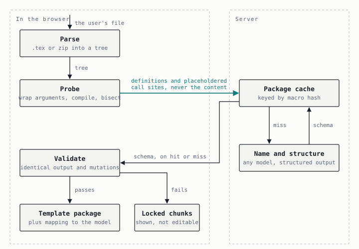

# LaTeX Resume Editor Plan

> This file is the plan (decision 0048). It was converted on 2026-09-13 from a shared page, which is no longer kept up.

*A browser editor for one-page LaTeX resumes, where you edit the typeset page itself and never see a line of TeX.*

Version one plan · revised 5 October 2026 · spike done, follow-ups merged

## 1. Key terms

For readers who have never used LaTeX. Every entry is two sentences at most, and the rest of the plan assumes nothing beyond them.

### 1.1 The LaTeX world

- **TeX**: The typesetting program underneath everything here, written by Donald Knuth in the late 1970s. It turns text and commands into precisely laid-out pages, and its output still looks better than most word processors.
- **LaTeX**: A large set of commands built on top of TeX that makes it practical for everyday documents. A resume written in LaTeX is a plain text file of words and commands that a program turns into a PDF.
- **Source, or the .tex file**: The plain text file holding a document's words and commands. It is the code that people using this product never see.
- **Compile**: Running an engine over the source to produce the finished pages. Every change has to be compiled to be seen, which is why compile speed decides whether page editing feels live.
- **Preamble**: The top of a source file, where fonts, page size and the template's commands are set up before any content appears. It is the slow part of every compile, and the part this plan compiles once and saves.
- **Template**: A ready-made design for a document: a preamble plus a set of custom commands that decide fonts, columns and spacing. The author supplies only content.
- **Macro**: A custom command a template defines, such as one that lays out a job entry from a company, a title and dates. An import never needs to know what a macro's inputs mean: the engine shows which of them a person can type into.
- **Package and class**: Add-on files that give LaTeX abilities such as icons, colours or multiple columns, where a class is the add-on that defines a whole document type. Templates lean on both.
- **TeX Live**: The standard distribution of LaTeX: the engines plus thousands of packages and fonts, several gigabytes in all. This plan fetches only the pieces a document actually uses.
- **Format file**: The engine's memory saved to disk after it has read a preamble. Loading it takes milliseconds, where reading the preamble again would take most of a compile.
- **DVI and XDV**: The engine's raw output before it is turned into a PDF, where XDV is XeTeX's version. It is easy for a program to read, which is why the page view is built from it.
- **Glyph**: One drawn character on the page. The page view is built from glyphs, and a click lands on one.

### 1.2 The engines

An engine is the program that does the compiling. LaTeX has three in common use, every template is written for one of them, and a template written for one often will not run on another.

- **pdfTeX**: The classic engine, fast and small. It can only use fonts packaged in its own format, which is enough for most resume templates.
- **XeTeX**: An engine that can use any font a computer has, including icon fonts. Templates with custom fonts or icons usually need it, and it is slower to start.
- **LuaTeX**: The newest engine, which can be programmed with the Lua scripting language. It is the heaviest of the three to run in a browser, so version one refuses templates that need it.

### 1.3 Inside this plan

- **Template package**: Everything the editor needs to know about one template: its preamble, its macros, where markers go, and, for a built-in template, how its fields map onto the canonical model. An imported `.tex` gets one too, of its own preamble and files, while its outline says where its fields stand.
- **Canonical model**: The one structure the built-in templates and PDF imports store a resume in: contact details, then sections of entries and lists, which is what will let those documents switch templates later without a migration. An imported `.tex` keeps its own shape instead, as an outline of its own LaTeX kept as it is, the fields the probe proves, and the bullets and entries that repeat.
- **Style control**: A setting the user can change without touching the template, such as margins or font size. Each one is a parameter the template package declares, with a fixed range.
- **Marker**: An invisible note the template writes into the output before and after each editable field. It is how the page knows which glyphs belong to which field.
- **Overlay**: The editable box that appears over a field while it is being typed into, set in the same font as the page. It makes typing feel instant while the real compile catches up.
- **Probe**: A compile run only to test whether one part of a template can be marked without changing the document. Probes are how the engine, rather than the AI model, discovers what is editable.
- **Kept text**: Everything in an imported `.tex` that is not a field, the template's code and any text the pipeline could not prove safe to type into, written back exactly as the upload had it. Its words show on the page with a lock, and the retype can change those that are plain text, checking each edit with a compile.
- **Corpus**: A collection of a few hundred real resumes gathered for testing. The share of them that import cleanly is the plan's headline quality number.

### 1.4 The web side

- **WebAssembly**: A way to run programs written for ordinary computers inside a web browser at close to full speed. It is how the TeX engines run on the user's own machine with no server involved.
- **Web Worker**: A way for a web page to do heavy work in the background so the page itself never freezes. The compile runs in one.
- **SVG**: A picture format made of shapes and text rather than pixels, which a web page can treat as separate clickable pieces. The typeset page is shown as SVG so that every character can be clicked.
- **CDN**: A network of servers that hands files out quickly from wherever the user happens to be. The pieces of TeX Live come from one.
- **Cache**: A saved copy of something expensive to produce, kept so the next request is instant. This plan caches format files and TeX Live pieces in the browser.
- **Hash**: A short fingerprint computed from a piece of text, identical whenever the text is identical. It is how a saved format is recognised, so the same preamble is never compiled into a format twice.
- **Debounce**: Waiting a moment after the last keystroke before doing expensive work, so typing a word triggers one compile rather than five.

### 1.5 The AI side

- **Language model**: An AI system that reads text and writes text. Here it has one narrow job, saying what each line of an imported PDF is, and only once the person has agreed to send the PDF's text.
- **Model choice**: The model is the school's during development, through its free gateway, and who provides it at launch is not yet decided. Whichever answers, rules stand in when it fails or the person says no, and the person reviews what was read before the document is made.
- **Structured output**: Asking the model to answer in a fixed, machine-checkable shape rather than free text. The answer can then be used directly by the pipeline without reading prose.

## 2. Summary

The product is a resume editor that runs in the browser. A person picks one of our templates, or imports the resume they already have: a `.tex` keeps its own look, and a PDF's content moves onto one of our templates. They click anywhere on the typeset page, type, and download a PDF. The LaTeX that produces the page exists, but nobody who uses the product ever reads or writes it.

BaKoMa TeX Word did direct page editing on real TeX in the 2000s for any LaTeX document, and it was fragile for exactly that reason: an arbitrary document cannot be understood, only run. This plan narrows the target to small, template-shaped documents and makes the tool own the source. Three ideas carry the design.

> **Note.** BaKoMa TeX Word, by Basil Malyshev, was a commercial editor in which you typed straight into the compiled page. It was the closest thing to this product, and it was aimed at TeX experts editing arbitrary documents.

- **The page is the editor.** The view is the real TeX output rendered as SVG, one element per glyph. A click lands on a glyph, the glyph belongs to a field, and the field opens for typing in place.
- **The tool owns the source.** Every document is structured data plus a template package, and the LaTeX is generated from those two things. An imported `.tex` carries its own LaTeX inside that data, but a person only ever types text, which the editor escapes, so there is no code for a user to break.
- **The compiler checks the import.** For an imported `.tex`, the TeX engine discovers which parts can be typed into and which repeat, and compile-based checks accept or reject each, with no model asked. Anything unproven stays visible, kept as the upload had it.

## 3. Decisions

Everything settled so far, including the defaults chosen on 12 September, the two revisions of 13 September, the revision of 16 September that moved template switching out of version one, the revision of 17 September that records what the spike measured, the revision of 3 October that restates the privacy rule as one sentence, the revisions of 4 October that take in the second pass of milestone 3 (decision 0049), and the revision of 21 October that takes in milestone 4: originals kept in Supabase Storage and sync as a queue of whole documents (decisions 0090 and 0092). Rows carrying the default tag were recommendations accepted without discussion, so they are the first to revisit if something feels wrong in practice.

| Question | Decision | What it changes |
|---|---|---|
| Who edits | Non-technical people with small documents | No escape hatch may ever show LaTeX |
| First documents | Resumes. Cheat sheets later | No math editor and no free-form columns in version one |
| Where it runs | The browser | TeX engines compiled to WebAssembly, packages fetched on demand |
| Edit surface | The real typeset page | The compile sits in the edit loop; an overlay covers the gap |
| Where templates come from | Curated templates plus import of any `.tex`; a PDF brings its content, not its template | An imported `.tex` keeps its own template and its shape as an outline; a PDF's content goes onto a curated template (decision 0049) |
| Understanding imports | Nothing is inferred: the engine proves what can be typed into and what repeats (decision 0049) | The engine probes first, the outline is built from what it proves, and the compiler validates last; no model is asked and nothing is sent |
| Which model | Only for labelling a PDF's lines: the school's during development, the provider at launch still open | Called in one place, after the person's yes, with a closed list of roles; rules answer without it, and invented resumes, never the corpus's, measure it |
| Output | PDF only | Generated LaTeX need not be readable; an imported `.tex` keeps its own LaTeX byte for byte around its fields |
| Structure editing | Side panel, with text edited on the page *(default)* | The cheapest interaction layer, reversible later |
| Style controls | In version one, with the fixed set in section 5.4 | Controls are parameters applied after the format is saved, so a change costs one ordinary compile |
| Languages | English first | Latin fonts only; pdfTeX suffices for curated templates |
| Storage | Browser storage plus accounts with cloud save | A document store, not a live sync engine: a queue sends each document whole with the version it started from, and a conflict keeps this device's version as a copy, so nothing is merged and no edit is lost (decision 0092) |
| Collaboration | None in real time | No shared editing state, no presence, no merging |
| Template switching | Later. Version one keeps one template per document | The canonical model stays for the built-in templates and PDF imports, so switching can be added for them later without a migration; an imported `.tex` keeps its own shape as an outline and cannot switch (decision 0049) |
| LaTeX or Typst | LaTeX, because importing LaTeX templates is the point | Settled and not raised again |
| Engines at launch | pdfTeX and XeTeX *(default)* | LuaTeX imports are refused with a clear message |
| Import intake | A single `.tex` or a zip *(default)*, or a PDF for its content (decision 0049) | Overleaf links later; Overleaf exports a zip anyway. A scanned or password-protected PDF is refused in plain words |
| Locked content | Kept text, shown locked, its plain words retyped in place (decision 0042) | No model: the compiler checks each retype and keeps it only when nothing outside the part moved |
| Import success bar | Identical output and 90% of body words editable *(default)* | Below the bar an import is labelled partial |
| Shared cache | None: an imported `.tex` sends nothing, so there is nothing to share (decision 0049) | Originals stay in the owner's account only |
| What leaves the browser | Resume content, only when the person asks for something that needs it and is told what is sent; the receiver keeps only what the person asked to be kept (decision 0047) | Saving to an account and sending a PDF to the checker are such requests; a later feature that sends resume content asks once, remembers the answer and says each time that it sends |
| Launch templates | Jake's Resume, AltaCV, Awesome-CV *(default)* | Covers pdfTeX, icons, two columns and XeTeX |
| Tech stack | TypeScript throughout, React, TeX engines built to WebAssembly from TeX Live sources *(default)* | Four parts are written from scratch; everything else is assembled, see section 8 |
| Hosting | Cloudflare for the files that are the same for everyone and the model endpoint, Supabase for sign-in, saved resumes and private originals *(default; originals moved to Supabase by decision 0090)* | Downloads are free on one, accounts and per-person files are nearly free to build on the other |
| XeTeX fonts | Declared in the format by file name, with fontspec removed from the class at import time (decision 0003) | A format cannot hold a loaded system font, so nothing loads until the first compile; Awesome-CV compiles in about half a second instead of ten |
| Overlay line breaking | The overlay breaks lines with TeX's own algorithm and the font's metrics (decision 0004) | A multi-line field sits within a pixel of the page; the template package carries each field's paragraph settings |

## 4. Scope of version one

### 4.1 In

- Three curated templates, each a hand-written template package.
- Import of a single `.tex` file, or a zip holding the document with its class files, style files and images.
- Import from a PDF: its content, not its look, lands on a built-in template the person picks, and a hosted model helps read it only once the person agrees.
- Text editing in place on the typeset page, with instant feedback in an overlay and the true page following within the target time.
- Adding, removing and reordering entries and sections from a side panel.
- Style controls: page size, margins, font size, font, accent colour, density and date format, plus a fit-to-one-page action.
- PDF download.
- Documents saved in the browser, and in the user's account once they sign in.
- English text and Latin fonts.

### 4.2 Out, with the door left open

- Cheat sheets, and the visual math editor they would need.
- Switching templates with content preserved. The canonical model is built so this can be added later.
- Style controls beyond the version-one set, such as heading styles, bullet shapes and column widths.
- Icon fonts and system fonts beyond what the launch templates use. XeTeX ships at launch, so this is a template question rather than an engine question.
- Non-Latin scripts.
- Real-time collaboration.
- Exporting `.tex`.
- LuaTeX templates, Overleaf links, and keeping a PDF's own look or reading a scanned PDF.

### 4.3 Targets

These are bars to clear, not measurements: the spike's for editing and loading, and for imports those the owner set on 4 October 2026 from the second pass's two spikes (decisions 0050 and 0051). They are judged on an M4 Pro, in Node and in the browser (decision 0066).

| Path | Target |
|---|---|
| Keystroke in the overlay | under 16 ms |
| True page updated after an edit, typical | 300 ms |
| Import of a `.tex`, pdfTeX | under 8 s, judged on Jake's Resume's own sample; the other families reported |
| Import of a `.tex`, XeTeX | 20 s, an aim |
| An imported `.tex`'s page, pdfTeX | open within 8 s for at least 66 of the corpus's 91 imports; the slowest under 60 s, and every field open under 120 s |
| An imported `.tex`'s page, XeTeX | open within 20 s for at least 17 of the corpus's 19; the slowest under 36 s, and every field open under 40 s |
| True page updated after an edit of an imported `.tex` | within 300 ms for at least 104 of the 108 the corpus can type in; the slowest under 700 ms |
| Import of a PDF, read by rules | under 1 s |
| Reading a PDF with the hosted model | a time budget of 15 s, after which the rules answer |
| First load, cached afterwards | under 30 MB |

Measured on 17 September on an M4 Pro: the page updates in 100 to 110 ms for Jake's Resume and 459 ms for Awesome-CV, the first load is about 14 MB compressed, and the overlay sits within a pixel of the page. Measured on 5 October on the same machine, in Node (decision 0064): a `.tex` import takes 2.56 s on pdfTeX for Jake's Resume's own sample and 18.51 s on XeTeX for Awesome-CV's, a PDF read by rules takes 73 ms at the slowest, and the hosted model's reading 9.0 s at the slowest of 51 calls, with 93.4 to 95.7% of fields right on invented resumes from other tools. In the browser on the same day (decision 0066): an edit's page in 82 ms, a `.tex` import in 2.96 s on pdfTeX and 17.87 s on XeTeX with the engine's start, and a PDF read by rules in 127 ms at the slowest, its pages drawn for the review.

An imported `.tex` also has targets for what it makes editable, the follow-ups run's of 7 October 2026 (decision 0074): at least 86.5% of body words editable in place over the corpus's resumes that import, no family of forks lower than on 6 October (Jake's Resume 94.8%, Awesome-CV 93.5%, AltaCV 83.0%, europecv 78.1%, moderncv 83.8%, no known template 76.2%), at most 4 resumes under 50%, and at least 68 at the 90% bar of section 6.2; and the slowest whole import of a `.tex` on pdfTeX under 100 s. At least 90% over the forks of Jake's Resume, Awesome-CV and AltaCV stays the aim, which AltaCV's do not reach (decision 0066). Measured on 6 October on the same machine, in Node, on main with the perf run's fixes merged (decision 0072): 84.6% of the words in place, 5 resumes under 50% and 61 at the bar; an imported page open within 8 s for 66 of 91 on pdfTeX, the slowest at 47.9 s and every field open by 72.7 s, and within 20 s for 17 of 19 on XeTeX, the slowest at 25.8 s and every field by 28.2 s; and an edit of an imported resume on the page within 300 ms for 105 of 107, the slowest at 549 ms. In the browser on the same day: Jake's Resume's sample opened at 1.71 s and imported in 2.52 s, Awesome-CV's opened at 10.60 s and imported in 16.29 s, and an edit after importing each upstream sample on the page in 84 to 299 ms. Measured on 7 October on the same machine, in Node, on main with the follow-ups run's fixes merged (decision 0079): 87.7% of the words in place (Jake's Resume's forks 97.3%, Awesome-CV's 94.2%, AltaCV's 89.6%, europecv's 78.1%, moderncv's 87.0%, no known template 80.0%), 3 resumes under 50% and 75 at the bar; the slowest whole import on pdfTeX 88.6 s; an imported page open within 8 s for 66 of 91 on pdfTeX, the slowest at 49.7 s and every field open by 79.0 s, and within 20 s for 17 of 19 on XeTeX, the slowest at 26.3 s and every field by 28.9 s; an edit of an imported resume on the page within 300 ms for 104 of 108, the slowest at 572 ms; and Jake's Resume's own sample imported in 4.23 s on pdfTeX, its page at 1.96 s, and Awesome-CV's in 17.51 s on XeTeX. In the browser on the same day: Jake's Resume's sample opened at 1.86 s and imported in 4.08 s, Awesome-CV's opened at 11.59 s and imported in 17.24 s, and an edit after importing each upstream sample on the page in 87 to 307 ms. The markers-and-transform run of 7 October 2026 raised the bars for what an imported `.tex` makes editable (decision 0082): at least 88.8% of body words editable in place, at most 1,000 words kept as `moved` because a marker or a transformation moves the page, at least 78 resumes at the bar, no family of forks lower than on main after the follow-ups run (the numbers of decision 0079 above), and 0074's time and typing targets held. Measured on 7 October on the same machine, in Node, on main with the marker macro (decision 0080) and the page's translations (decision 0081) merged: 89.7% of the words in place (Jake's Resume's forks 97.9%, Awesome-CV's 94.2%, AltaCV's 94.3%, europecv's 78.9%, moderncv's 91.0%, no known template 82.5%), 657 words kept as `moved`, 2 resumes under 50% and 83 at the bar; the slowest whole import on pdfTeX 87.2 s; an imported page open within 8 s for 69 of 91 on pdfTeX, the slowest at 48.7 s and every field open by 77.8 s, and within 20 s for 17 of 19 on XeTeX, the slowest at 25.8 s and every field by 28.3 s; an edit of an imported resume on the page within 300 ms for 104 of 108, the slowest at 552 ms; and Jake's Resume's own sample imported in 4.01 s on pdfTeX, its page at 1.85 s, and Awesome-CV's in 16.98 s on XeTeX. In the browser on 8 October: Jake's Resume's sample opened at 1.85 s and imported in 4.06 s, Awesome-CV's opened at 11.73 s and imported in 17.55 s, and an edit after importing each upstream sample on the page in 88 to 319 ms. docs/milestone-3-overhaul.md holds the rest, the accuracy of a PDF import's reading among them.

## 5. Architecture

### 5.1 The template package

A template package is the one artefact everything else consumes. A built-in template's package holds the preamble verbatim, a schema for each custom macro and environment the template defines, a marker strategy for each editable argument, the parameters a future style panel will expose, and a mapping from the template's fields onto the canonical model, and it is written by hand. An imported `.tex` gets its package from the pipeline in section 6, holding its own preamble and files and the controls the checks prove, with no mapping: its fields stand in its outline (section 5.2). The page treats the two alike, and the side panel does not.

> **Note.** The spike answered the first question it was asked: XeTeX cannot keep system fonts inside a format file. The format holds font declarations that name the files instead, and nothing loads until the first compile, which brings Awesome-CV to about half a second (decision 0003).

### 5.2 The canonical model

The built-in templates store a document in one model: a header with contact fields, then sections, each holding either entries with a title, subtitle, place, date range and bullets, or a plain list such as skills. Each built-in package maps its macros onto that model, and the generator walks the model to emit the template's LaTeX. A PDF import fills the same model, since a PDF has no source to keep: its text is read into the header, the sections, the entries and the bullets, and the built-in template the person picks sets it. Template switching is not in version one, but because these documents already live in this model, adding it later is a feature rather than a migration.

An imported `.tex` keeps its own shape instead (decision 0049). It is stored as an outline: kept text, the upload's own LaTeX written back byte for byte, which only the retype changes; fields, the pieces the probe proves a person can type into, where they stand in that LaTeX; and groups of units, the bullets and entries that repeat, found from the source itself, which can be copied, removed and moved. The outline is a kind of section the same model holds, so one definition still covers every document, and nothing is lost on import. Nothing in an outline says which text is a company and which a date, so an imported `.tex` cannot switch templates or take the date format control, and its side panel lists the outline's parts by their first words instead of a labelled form.

> **Note.** RenderCV is an open-source tool that renders a YAML resume through LaTeX themes. It is the closest existing example of a canonical model with a mapping per template, and worth reading before designing ours.

### 5.3 Client

The page is an SVG built by us from the engine's output, one element per glyph, so a hit test is a DOM lookup. Clicking a glyph finds its field through the markers around it and opens an editable overlay positioned exactly over the field, set in the document's own font served as a web font. The overlay breaks its lines with TeX's own algorithm and the font's metrics, so a multi-line field sits within a pixel of the page (decision 0004). Keystrokes land in the overlay instantly. The edit is applied to the model after a short debounce, and when the recompile lands, the fresh page replaces the old one and the overlay closes. A side panel holds structure: add or remove an entry, reorder sections. Documents live in a local-first store in the browser and sync to the account when one exists: the browser always writes first, and a queue beside the store sends each document whole, naming the version it started from, and brings in newer versions from other devices (decision 0092).

### 5.4 Style controls

Resumes are edited to fit, so the controls that change how much fits are in version one. The set is deliberately small. Each control is one parameter with a fixed range, which keeps every template predictable and keeps fit-to-one-page a short search rather than an open-ended one.

| Control | Choices | Notes |
|---|---|---|
| Page size | US Letter, A4 | Defaults from the browser's locale |
| Margins | 0.4 to 1.0 inch in steps of 0.1, the same on all sides | A slider with Tight, Normal and Roomy marked on it |
| Font size | 9 to 12 pt in half-point steps | The usable range for a resume; the template's own size is the default |
| Font | Three or four families per template | Only families the template's engine can load from TeX Live, so a choice never changes the engine |
| Accent colour | A short palette plus a custom picker | Applies wherever the template uses colour: headings, rules, icons |
| Density | Compact, Normal, Relaxed | Scales the space between sections, entries and bullets together |
| Date format | Jan 2024, January 2024, 01/2024, 2024 | One setting for every date in the document |
| Fit to one page | An action, not a setting | Steps density, then margins, then font size until the document fits, and undoes in one click |

Section order is a structure edit and lives in the side panel with the other structure edits.

Every control is a parameter declared in the template package with a type and a range, and the controls are applied after the point at which the preamble has been saved as a format file. That ordering is what keeps them fast. Page geometry, colours and fonts can all be set after the packages have loaded, so changing a control costs one ordinary compile, the same as typing. Font size is the exception, because some classes fix it when they load; those templates get one saved format per size, which is a handful of small files.

An imported `.tex` gets the controls the pipeline can prove: page size, margins and font size, each overridden generically and kept only where a compile shows that it changes the output and breaks nothing. Accent colour, font and density came from the model's reading of the preamble, which went with the naming step, and date format needs to know which text is a date, so an imported `.tex` has none of these four. A PDF import is set by a built-in template and has every control.

Fit to one page runs a short search in the worker: one step of density, then one of margins, then one of font size, compiling after each, and it stops at the first setting that fits. At the target compile time it finishes in a few seconds.

### 5.5 Compile worker

A Web Worker hosts pdfTeX and XeTeX compiled to WebAssembly. TeX Live files are fetched on demand from a CDN and cached locally, so the first compile of a template pulls what it needs and later ones pull nothing. Each preamble is compiled once into a format file and cached, which removes most of the cost of every later compile. Output is DVI, or XDV from XeTeX, rather than PDF. Our converter turns it into SVG with the markers preserved. The PDF for download comes from the same output through the engines' standard drivers, also compiled to WebAssembly.

The spike built this loop and measured it: pdfTeX from a saved format in about 100 ms, XeTeX with fontspec removed and the fonts declared in the format in about 460 ms, TeX Live files fetched one by one as TeX opens them so a first load is about 14 MB compressed and a body compile fetches 0.06 MB, Type 1 fonts read in the browser, and XDV's native-font runs drawn from the font files. The stock format is fetched only to build a template's own format; serving template formats from the cache would remove it from the first load.

> **Note.** Markers written with `\special` pass through DVI untouched, and the on-screen page and the downloaded PDF come from the same output, so the two cannot disagree.

***Figure 1. The edit loop.** The teal path is instant: a click resolves a field and keystrokes land in the overlay. The dark path is the compile: the debounced edit regenerates the body, the worker recompiles from the cached format, the converter rebuilds the SVG, and the new page swaps in under the overlay.*

### 5.6 Backend

Sign-in, a document store, the model endpoint that labels a PDF's lines, and the TeX Live CDN. The document store holds the structured data, a reference to the package, and for imports the original upload, visible only to its owner, in a private Supabase Storage bucket under the owner's own folder (decision 0090). There is no synchronisation engine that merges, because nothing is edited by two people at once: sync is a queue of whole documents with a version check, and a conflict ends in two documents (decision 0092). The database's own row-level rules, not the browser, decide who can reach a row or a file (decision 0093). Section 8 names the services behind each of these and what they cost.

### 5.7 Validation harness

One code path checks packages. In continuous integration it runs against the curated templates on every change. At import time it runs in the user's browser against the package the import has just built. A corpus of a few hundred public resumes, collected before the pipeline exists, is the regression suite, and the fraction of them that import fully editable is the number the whole import effort is measured by.

## 6. Import pipeline

Six steps, in order, for a `.tex` import. All of them run in the user's browser, because the engine is already there, and nothing leaves it. A PDF takes a path of its own, described after Figure 2.

1. **Intake.** Accept a `.tex` or a zip. Find the main file by looking for the document class. Detect the engine from the class and packages: font loading through fontspec or polyglossia means XeTeX, and anything that needs Lua is refused with a message that says so. Compile the original once to have a reference output.
2. **Parse.** A fault-tolerant parser turns the body into a tree. Standard LaTeX becomes rich text: bold, italic, links, lists. Calls to macros the template defines become typed calls. Anything the parser cannot place becomes a raw chunk that is preserved byte for byte.
3. **Probe.** Every argument of every custom macro call is wrapped in markers and the document is compiled. Arguments whose markers come out intact around exactly their text are editable prose. Arguments that break the compile or vanish are lengths, colours, icon names or keys, and are found by re-running with one probe at a time. Text in the output that no marker covers is locked.
   > **Note.** Probing is what lets an import do without a model: the engine shows what can be typed into, and the outline needs nothing more.
4. **Build the outline.** The import walks the body's tree with the probe's verdicts. Each piece the probe judged editable is a field, where it stands in the person's own LaTeX, and the rest of a call, an environment or a paragraph is kept text, written back byte for byte. What repeats is found from the source itself: a list's items are a group of units, and so is a run of calls to the same command. A new unit is a copy of the one beside it with its fields emptied, so no command needs to be named: no language model is asked, and a `.tex` import sends nothing at all (decision 0049).
5. **Validate.** Four checks, each a compile, with no answers to check. The outline compiled must produce the same glyph stream as the reference, markers stripped, and a field whose rewriting moves it becomes kept text. Every field set to long, empty and special-character text must still compile: one that breaks only when empty is required, and one that breaks on text becomes kept text. Every group must take a copy of its last unit and lose its first and its last; a group that cannot is fixed, and the editor neither adds to it nor removes from it. Page size, margins and font size are each overridden and compiled, and become controls only if the output changes and nothing breaks.
6. **Package and report.** The package and the document, its outline, are stored, and the document opens in the editor. The import report states the shares of body words editable in place, changeable through the retype and locked, and lists what is locked and why. Below the bar in section 6.2 the report says partial and the user decides whether to continue.

***Figure 2. The import pipeline, as the first pass drew it.** Parse, probe and validate stand as drawn. The server half, the package cache and the naming step it called on a miss, is gone since decision 0049, and with it the teal arrow that carried macro definitions and placeholdered call sites out of the device: the outline is now built in the browser from the probe's verdicts, and a `.tex` import sends nothing. What passes validation becomes a field and what fails stays kept text, shown locked, in a package that keeps no mapping to the canonical model.*

A PDF import takes another path. Its text and links are read in the browser, and rules find its lines, columns, bullets and reading order. Each line is then labelled, a name, a contact, a heading, an entry's head, a date, a place, a bullet or running text, by the hosted model where the person has agreed and by rules otherwise (section 6.4). The labelled lines are filed into the canonical model, every word read is counted against the resume built, and a review shows the PDF beside what was read, the flagged items first, before the document opens in the built-in template the person picks. It promises the content, not the look, and a scanned or password-protected PDF is refused in plain words.

### 6.1 Locked content

Words on the page that no field holds are kept text: they render exactly as they did in the original and show a lock when hovered. They change only through the retype (decision 0042). Where they are plain text in the upload that lines up with the page, a click opens them for typing, and the compiler checks that the document still compiles, that the words come out as typed and that nothing outside the part moved. The user sees either the new page or a plain refusal, and never the LaTeX in either case. No model is asked: a sentence typed at a chunk for a model to rewrite would send the resume's text out, and the retype needs none.

### 6.2 Success bar

An import succeeds when its outline compiled produces the same glyph stream as the original, markers stripped, and at least 90% of body words are editable in place. The report counts three shares, the words editable in place, those the retype can change and those locked, with each locked part's reason in plain words; the retype's words are reported beside the bar and do not count toward it. Below the bar, the report labels the import partial, lists the locked parts, and lets the user continue or stop. The corpus measures both conditions across real documents.

### 6.3 Privacy

The rule, since 3 October 2026 (decision 0047): resume content leaves the browser only when the person asks for something that needs it and is told what is sent, and whoever receives it keeps only what the person asked to be kept. A feature that sends resume content asks the first time, remembers the answer in that browser with a setting to change it, and says each time that it sends. The naming step sits well inside the rule, because it sends none of the resume's content at all.

With the second pass of milestone 3 (decision 0049), the naming step leaves the import, and a `.tex` import sends nothing at all, not even its template's code. The shared cache of what the model worked out about each template's macros goes with it, so there is no shared store left to keep personal data out of. The original upload is stored in its owner's account and nowhere else (in Supabase Storage, decision 0090).

Of the two ways in, only a PDF import sends resume content, and only once the person agrees. The first time a person imports a PDF, they are asked whether PDFs' text may be sent to be read, in plain words that say what is sent and that nothing is kept. The answer is remembered in that browser, a setting changes it, and every later import says in one line that the text is being sent. The service keeps no text, in a cache or in a log, and for a person who says no the PDF is read by rules in the browser, with nothing sent.

### 6.4 Model choice, cost and time

A `.tex` import asks no model. A language model now has one job: once the person has agreed, it says what each line of a PDF is, a name, a contact, a section's heading, an entry's head, a date, a place, a bullet or running text, as one role from a closed list so that a reply is valid by construction. Rules always do the geometry before it, the lines, columns, bullets and reading order, and rules give the roles instead for a person who has not agreed, or whenever the service fails, replies in the wrong form or runs past its time budget. The review says which read the PDF, and everything stays editable afterwards.

The model is the school's during development, served free through the School of Computing's gateway for its students and staff, starting from the one chosen for naming (decision 0044). Who provides it at launch stays open, as section 8.3 has it, and is settled before launch: the school's service needs the school's leave before it reads real people's resumes, and a paid service, which costs money for each import, must have terms that rule out training on what it is sent. No model is called in continuous integration, and no resume of the corpus is given to one.

A `.tex` import costs only compiles, the probe's and the checks', with a progress display that names each step; on pdfTeX it stays under 8 seconds on Jake's Resume's own sample, the other families reported. A PDF read by rules takes under a second, and the model's reading has a budget of 15 seconds, after which the rules answer. Section 4.3 holds the targets the owner set on 4 October 2026, and docs/milestone-3-overhaul.md the rest.

## 7. Launch templates

Three ports rather than original designs, chosen so that between them they exercise every path the engine layer has to support. All three are popular enough that many imports will be forks of them, and they are the templates a PDF import's content lands on.

| Template | Engine | Layout | Licence | Why |
|---|---|---|---|---|
| Jake's Resume | pdfTeX | single column | MIT | The most forked software resume on GitHub |
| AltaCV | pdfTeX | two columns, icons | MIT | Exercises columns and icon fonts without XeTeX |
| Awesome-CV | XeTeX | single column, custom fonts | LPPL | Forces the XeTeX and system-font path early |

Confirm each licence before porting.

> **Note.** The LaTeX Project Public License allows modified copies but asks that they not be presented as the original, which in practice means renaming the ported class and keeping attribution.

## 8. Tech stack and hosting

Everything is written in one language, TypeScript, and runs in three places: the user's browser, a background thread inside that browser, and a small server. The stack is chosen so that the four things nobody else has built, the page converter, the marker-driven overlay editor, the template packages and the import pipeline, are the only things written from scratch. Everything else is assembled from open-source parts.

### 8.1 The stack

| Layer | Choice | Why |
|---|---|---|
| Language | TypeScript everywhere | One language for the app, the background thread, the import pipeline and the server; the engines are driven through JavaScript anyway |
| App | React with Vite | A commodity choice; none of the hard parts live in the framework |
| Typing in fields | ProseMirror through Tiptap, with only bold, italic and link | A predictable document model that maps one-to-one onto the LaTeX equivalents |
| Document state | The canonical model as plain JSON, checked with Zod, with a command stack for undo, for the built-in templates and PDF imports; an imported `.tex` keeps its own shape as an outline, a kind of section the same model holds (decision 0049) | Simple, and it saves and syncs as one blob |
| Local storage | IndexedDB through Dexie for documents and formats; the browser's Cache API for TeX Live files | Immutable files suit ordinary HTTP caching; documents need lookups |
| TeX engines | pdfTeX and XeTeX built to WebAssembly with Emscripten from TeX Live sources, starting from BusyTeX's build scripts | An own build keeps licensing to TeX's own terms and leaves room for an engine patch later |
| Engine host | One Web Worker, one engine loaded at a time, files fed on demand | Keeps memory down on old laptops |
| TeX Live on demand | A static copy of the needed TeX Live files in object storage behind a CDN, with a manifest | Fetch only what a document uses, then cache it for good |
| Page rendering | An own DVI and XDV to SVG converter in TypeScript, started from dvi2html | Exact per-glyph positions, markers preserved, an SVG the browser can hit-test |
| Web fonts | Web fonts made from each template's own font files, Computer Modern's Type 1 outlines included, so the overlay uses the page's exact glyphs | Needed for the overlay; the SVG draws the outlines directly |
| PDF export | dvipdfmx and xdvipdfmx built to WebAssembly | The download comes from the same output as the screen, so the two cannot differ |
| LaTeX parsing | unified-latex | The only serious JavaScript parser with a forgiving tree and a printer |
| Model endpoint | A small HTTP function on the Vercel AI SDK's provider layer that labels a PDF's lines, one role a line from a closed list | It holds the key, limits the rate and keeps no text; the provider at launch is open, and switching is a one-line change |
| Sign-in and saved resumes | Supabase: its sign-in, database and file storage, used directly from the browser through supabase-js, loaded only when needed; the private `originals` bucket holds imports' uploads (decision 0090); development and CI run its stack locally (decision 0089) | The least code that gets accounts working, with per-person rules in the database itself |
| Files and the server | Cloudflare: Pages for the app, R2 for the engine, fonts and TeX Live files, a Worker for the model endpoint, KV for its rate limit | Downloads are not metered, and the free tier never sleeps |
| Testing | The same WebAssembly engines run headless in Node; Vitest for units, Playwright for click-and-type flows, GitHub Actions running the corpus when a person starts it (decision 0035) | One pipeline in the browser and in continuous integration, as the plan requires |
| Repository | A pnpm monorepo with packages for the engines, the converter, the template packages, the pipeline, the app and the API | Clean lines between the four parts written from scratch |
| Containers | Docker for three jobs only: building the TeX engines and the TeX Live bundle, deploying the ATS service later, and running the local Supabase stack that accounts work and its CI run against, through the pinned Supabase CLI (decision 0089). Everyday development runs natively. Any Docker-compatible runtime works, such as Docker Desktop or OrbStack | Pinned Node, pnpm, uv and Python already make both laptops and CI match; the Emscripten build is the one thing they cannot pin, and a Python host takes a container anyway |

### 8.2 Hosting

Two services, split by what each is good at. Cloudflare serves everything large that is the same for everyone, because it does not meter downloads: the app itself, the engine, the fonts and the TeX Live files, plus the model endpoint that labels a PDF's lines, which sits next to those files in a Worker. Supabase holds sign-in, saved resumes and the originals of imported `.tex` files, because its sign-in, database and storage come already wired together and the app talks to them directly with no server code in between. Originals live there rather than on R2 because R2 has no rule of its own that limits a file to one person: a private original on R2 would need a Worker checking each person's Supabase session, server code between the two services (decision 0090). The two never talk to each other. Each is reached from the browser, so there is nothing to integrate.

The split follows from one number. A first visit downloads about 14 MB compressed (measured in the spike; 25 MB was the estimate), the engine plus a template's precompiled preamble and fonts, and then keeps it cached. Supabase's free tier allows 5 GB of downloads a month, which about 350 first-time visitors would use up, and shipping a new engine build makes everyone download it again. Cloudflare's Pages and R2 do not charge for downloads at any volume. Saved resumes are about 100 KB each, and an import's original a few hundred kilobytes, downloaded only when the document is first opened on another device; they are the only things that leave Supabase, so its limit is far off. Originals count against Supabase's storage, 1 GB on the free tier, which milestone 5 measures before deciding a cap per account.

| Download | Per visitor | 300 visitors in a month |
|---|---|---|
| The engine, a format and fonts, once, from Cloudflare | 14 MB | 4.2 GB, free |
| A saved resume, twenty opens, from Supabase | 2 MB | 0.6 GB, inside the free tier |
| The same engine files if they lived on Supabase | 14 MB | 4.2 GB, over the limit at visitor 350 |

### 8.3 What it costs

As a personal project, nothing until there are real users. Every part is open source or has a free tier the project will not exceed.

| Service | Free tier | When paying starts |
|---|---|---|
| Cloudflare Pages, hosting the app | Unlimited traffic, 500 builds a month | Effectively never |
| Cloudflare Workers, the model endpoint | 100,000 requests a day | $5 a month past that |
| Cloudflare R2, file storage | 10 GB, downloads free | Past 10 GB; a card on file may be asked for to switch it on |
| Cloudflare KV, the model endpoint's rate limit | Generous daily limits | Not at this scale |
| Supabase, sign-in, saved resumes and originals | Small database, 1 GB of storage that originals count against, 5 GB of downloads a month; a project pauses after a week idle | $25 a month to stop the pausing or grow; a cap per account on originals is milestone 5's to decide |
| The school's model gateway, during development | Free to its students and staff, within each key's daily limits | Never; reading real people's resumes on it needs the school's leave |
| A paid model service, if the launch takes one | None that fits: a free tier may train on what it is sent | For each PDF it reads, at 1,100 to 3,400 tokens in and 120 to 580 out (decision 0051) |
| GitHub Actions, corpus runs started by hand | 2,000 minutes a month on private repos, unlimited on public | Not at this scale |
| A custom domain | None; a free subdomain is provided | About $10 a year, optional |
| React, ProseMirror, unified-latex, the engines, the fonts | Open source | Never |

The first two milestones need no services at all: the spike and the curated editor run on a laptop. The server appears when a PDF import needs the model, and accounts come after that. One caution: a free tier may let its provider use what it is sent to improve its models, and a PDF import sends a resume's text once the person agrees. So the provider at launch must be the school's, with its leave, or a paid service whose terms rule that out.

### 8.4 The hard parts of the stack

- **Getting XeTeX into the browser.** XeTeX brings ICU, HarfBuzz and FreeType with it, and pushing all of that through Emscripten is the heaviest single engineering item. BusyTeX has done it, so the spike ran on its prebuilt binary, which holds all three engines in 30 MB; the own per-engine build is still to do. The build lives in a Dockerfile so it is reproducible on any machine, and CI publishes the resulting WebAssembly files so nobody rebuilds them unless the engine changes.
- **Licences on the engine builds.** pdfTeX is under the GPL and SwiftLaTeX's ready-made engines are, as far as can be told, under the AGPL. Building from TeX Live sources sidesteps the second, and the first needs a one-time read for a product that might charge money.
- **XeTeX's output dialect.** Done in the spike: the converter reads XDV's native-font instructions and draws the glyphs from the font files, with fake stretch and slant applied and emboldened runs still to draw.

## 9. Milestones

Built in this order because each step removes the biggest remaining unknown before the next step depends on it.

1. **Spike, done 16 and 17 September 2026.** Answer the questions the plan rests on. None of the first three failed; the findings are in decision records 0003 and 0004, and the follow-ups they called for are merged.
   - [x] Jake's Resume compiles in browser pdfTeX from a precompiled format in 100 to 110 ms on an M4 Pro.
   - [x] Awesome-CV compiles in browser XeTeX: 10.2 s with fontspec, 459 ms from a format with the fonts declared by file. System fonts cannot live in the format; the declarations can.
   - [x] Output converts to SVG with every marker preserved; on a 30-field page every glyph resolves to its own character and every field resolves from a click.
   - [x] The overlay uses the same font as the page. A three-line bullet shifted by up to 36 pt with the browser's line breaks and by at most 1 px with TeX's own breaker, which the overlay now uses.
   - [x] First load is about 14 MB compressed with TeX Live fetched on demand, two thirds of it the engine binary.
2. **Curated editor.** The package format, the three ported templates, page plus side-panel editing, the style controls and fit to one page, browser storage, PDF export, and a warning when content spills onto a second page.
   *Done means:* All three templates edit end to end within the targets, every style control works on all three, and the validation harness runs on every change.
3. **Import, done 5 October 2026.** Intake, parser, probes, the outline an imported `.tex` keeps, validation, kept text with the retype, the import report, the generic style controls on imports, and import from a PDF onto a built-in template. The second pass, docs/milestone-3-overhaul.md, plans them in place of the first pass's naming step (decision 0049).
   *Done means:* What docs/milestone-3-overhaul.md sets, with the targets the owner set on 4 October 2026 (section 4.3). Every corpus resume that compiles and is probed imports as an outline, making no network request, with at least 60% of their body words editable in place, 45 of them at the 90% bar and bullets that add and remove; and a PDF import lands every word it reads on a built-in template, sending nothing until the person agrees.
   *Measured:* 110 of the corpus's 117 resumes that compile import as outlines, 71.9% of their words editable in place and 53 at the 90% bar, in a run on main after the follow-ups (decision 0066); the 108 that imported before hold 73.9%, and Jake's forks reach 93.7%, Awesome-CV's 93.5% and AltaCV's 82.2% against 90% (decision 0060). A `.tex` import takes 2.56 s on Jake's Resume's sample and 18.51 s on Awesome-CV's, a PDF read by rules 73 ms at the slowest, and the model's reading 9.0 s at the slowest, with 93.4 to 95.7% of fields right (decision 0064). The two resumes the checks refused now import (decision 0065), and AltaCV's gap and the other known limits are accepted, not open (decision 0066).
4. **Accounts and cloud save, done 21 October 2026.** Sign-in by email link and by email and password, the document store, sync from the local store, and private storage of originals, built against a local Supabase stack, with no hosted project (docs/milestone-4.md, decision 0089). Google sign-in and deleting an account moved to milestone 5 (decisions 0094 and 0095).
   *Done means:* A document saved on one device opens on another, and an original upload is visible only to its owner.
   *Measured:* A built-in document, a `.tex` import with its original byte for byte and a PDF import each saved on one device open on another, in integration tests and by hand in two browsers; a second account and a client with no session reach none of them, in the database's own tests and through the browser's client. The `accounts` workflow runs in about 2 minutes, the stack's cold start 78 s of it, and the Supabase client is a 55 kB gzipped chunk that a signed-out first load never fetches (decision 0100).
5. **Launch.** Polish, the model endpoint hosted with a bot check and its provider settled, the corpus number published internally as the import quality metric, and accounts online: the hosted Supabase project, a mail provider for sign-in and reset, Google sign-in (decision 0094), deleting an account (decision 0095), and a cap per account on originals.

After launch, in roughly this order: template switching with content preserved, in-page structure editing if the side panel proves limiting, more style controls, cheat sheets with a visual math editor, LuaTeX, other scripts.

## 10. Risks

Each one is marked the way TeX marks an overfull line, and each carries its mitigation.

- **XeTeX cannot store system fonts in a format file.** Answered: it cannot, but the font declarations can live there and nothing loads until the first compile, so Awesome-CV takes about half a second rather than the second or more feared. pdfTeX templates stay the fast path and XeTeX templates keep a longer debounce; unicode-math is the exception at 3.6 s and stays in the body only for templates that typeset real mathematics.
- **Markers are defeated by some macros.** An argument used twice, placed in a moving argument such as a header, tested for emptiness, or set in verbatim will confuse or break marking. The probe detects each case and the field falls back to locked. The generator emits truly empty arguments so emptiness tests keep working.
- **The overlay shifts when the real page swaps in.** Measured: a three-line bullet moved by up to 36 pt with the browser's breaks. The overlay now has its own line breaker, a port of TeX's, and the shift is at most 1 px (decision 0004).
- **Messy forks keep much of their text locked.** An outline reaches only what the probe proves, and where a fork's commands break the probe, as in one resume of the second pass's sample, nearly all its words stay kept text (decision 0050). The retype reaches most kept text, the corpus metric tracks the rest, and the success bar keeps a poor import from looking like a good one. AltaCV's forks reach 82.2% of words editable in place, short of 90%, which is accepted (decision 0066).
- **Low-end devices run out of memory.** Two engines plus fonts is a lot for an old laptop. Load only the engine the document needs and unload the other. Nothing slower than an M4 Pro is measured (decision 0066). A PDF made to sit just under the reader's limits takes about 1.4 GB for a second before it is refused, in a worker that then frees it, which is accepted (decision 0066).
- **An import is slow.** With no model, a `.tex` import's time is its compiles: Jake's forks take a few seconds, but AltaCV's, moderncv's and XeTeX documents can take tens (decision 0050), so the 8 s bar is judged on Jake's Resume's own sample and the rest reported, with a progress display that names each step. Awesome-CV's own sample imports on XeTeX in 18.51 s, under its 20 s aim by a thin margin, which is accepted (decision 0066). Reading a PDF with the hosted model depends on a gateway that was down for a day and slow past a minute during the first pass, so the model's reading has a 15 s budget, after which the rules answer.
- **A PDF's text leaves the browser.** It goes only after the person's yes, and a remembered yes is easy to forget. Each import says in one line that it sends, a setting sits beside it, the service keeps no text in a cache or a log, and a test holds each (decision 0047).
- **A ported template's licence is misread.** Confirm each licence before porting, rename anything under LPPL, and keep attribution in the package.
- **Style controls throw away the precompiled format.** A control that changes the preamble would force a new format, which takes seconds. Controls are applied after the point where the format is saved, so a change is one ordinary compile, and font size, the one setting some classes fix at load time, gets one saved format per size.
- **A PDF is read wrongly and looks right.** A merged date or a bullet filed under the wrong entry reads as fine, whether the model or the rules labelled it. Every word read is counted against the resume built, doubtful lines are flagged, the review shows the PDF beside what was read, and everything stays editable afterwards. Rules read 68.8% of fields on the two invented layouts held out from their tuning, and read two columns whose lines share baselines as a table; both are accepted (decision 0066).
- **Model terms allow training on inputs.** Providers' free tiers often reserve that right, and a PDF import sends a resume's text. No resume of the corpus is ever given to a model, and the provider at launch is the school's with its leave or a paid service whose terms rule training out, checked before launch.

## 11. Deferred decisions

Parked on purpose. None of them blocks version one, and each is cheaper to decide with a working editor in hand.

- In-page structure editing, such as dragging entries around the typeset page.
- Template switching with content preserved; the canonical model already supports it.
- Who provides the model that labels a PDF's lines at launch: the school's, with its leave to read real people's resumes, or a paid service whose terms rule out training on what it is sent.
- Overleaf link intake.
- LuaTeX support.
- Non-Latin scripts and the font story they need.
- Cheat sheets and the visual math editor.
- Import from and export to the JSON Resume format.
- Version history and undo across sessions.
- Exporting the generated `.tex`.

---

*Written on 12 September 2026 from a design conversation and revised on 13 September to bring style controls into version one, leave the model choice open, and add the stack and hosting choices, on 16 September to move template switching out of version one, on 3 October to restate the privacy rule as one sentence (decision 0047) and to make this file the plan itself (decision 0048), and on 4 October to take in the second pass of milestone 3 (decision 0049) and, the same day, to bring the rest of the page in line with it and record the targets the owner set, and on 5 October to mark milestone 3 done, accept its known limits and judge the targets on the M4 Pro alone (decision 0066), and on 21 October to take in milestone 4: originals in Supabase Storage rather than R2 (decision 0090), sync as a queue of whole documents with a version check (decision 0092), the local Supabase stack as Docker's third job (decision 0089), and milestone 4 marked done (decision 0100). Decisions carrying the default tag were proposed and accepted without further discussion, and are the first to revisit if practice disagrees.*
